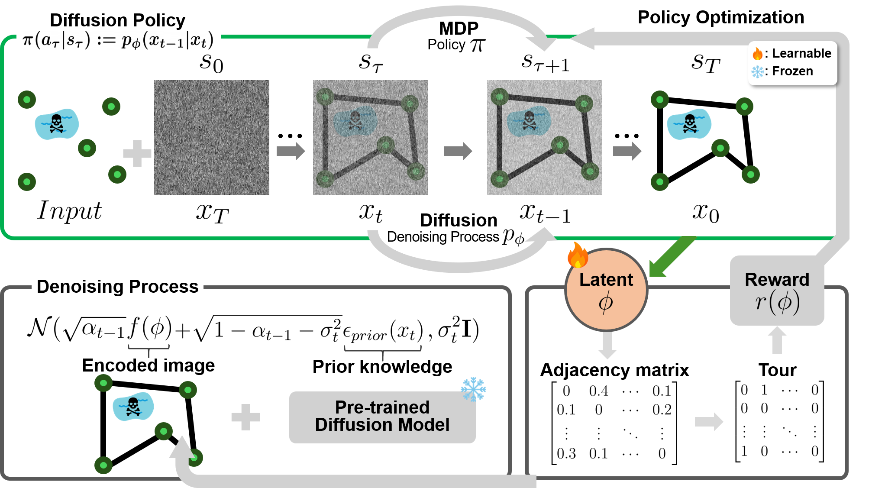
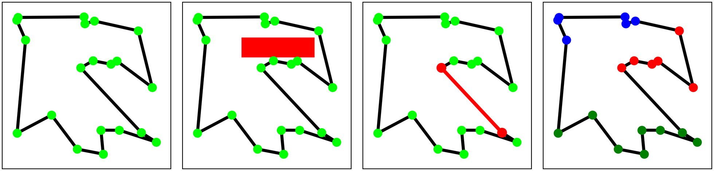

# DDRL: A Diffusion-Driven Reinforcement Learning Approach for Enhanced TSP Solutions

Official implementation of **DDRL: A Diffusion-Driven Reinforcement Learning Approach for Enhanced TSP Solutions** (**WACV 2027**), together with the constrained TSP benchmark introduced in the paper.

**Authors:** Joowang Kim, Jeyoon Yeom, Gyeongdeok Seo, Sungjun Lim, Jae Ha Gwak, Gyeong-Moon Park\*, Kyungwoo Song\*<br>
\* Corresponding authors.

[](LICENSE)


[Overview](#overview) · [Code layout](#code-layout) · [Installation](#installation) · [Running](#running) · [Benchmark](#constrained-benchmark) · [Citation](#citation)

## Overview

DDRL couples a pre-trained image diffusion model with instance-wise reinforcement learning.
A single learnable latent `phi` defines the adjacency matrix `A(phi)`; its edge image `f(phi)` is placed inside a DDIM denoising process, so each denoising trajectory is a policy rollout whose decoded tour is scored by the reward.
A clipped policy-gradient update (in the manner of DDPO) then moves the latent toward the trajectories of the better-scoring tours.
The pre-trained diffusion prior (or a DIFUSCO heatmap) supplies the initialization; the search itself needs no labels and no retraining.

<p align="center">
  
</p>

- **Basic TSP** (N = 20 to 1000): competitive with the compared learning-based and heuristic solvers.
- **Constrained TSP** (N = 20 to 200): the lowest gaps among the compared solvers on three benchmarks introduced here, where the constraint reaches the algorithm only through the reward.

<p align="center">
  
  <br><em>Left to right: basic TSP, obstacle (box), mandatory path, and cluster constraints.</em>
</p>

## Code layout

| path | what |
|---|---|
| `main.py` | entry point: loads instances, runs the search, writes the result CSVs |
| `ddrl/latent.py` | the latent phi, its adjacency matrix A(phi) and edge image f(phi) |
| `ddrl/sampling.py` | DDIM denoising with f(phi) as the clean image and per-step log-probabilities (Eq. 1) |
| `ddrl/search.py` | instance-wise optimization: candidates, advantages, clipped update, keep-best (Eq. 3, Algorithms 1 and 2); the controls |
| `ddrl/reward.py`, `ddrl/decoding.py`, `ddrl/solver.py` | reward (Eq. 2): greedy decoding, constraint-aware construction, lexicographic 2-opt and repair |
| `ddrl/prior_init.py` | the diffusion prior and the plug-and-play / DIFUSCO initializations (Supp. Eq. A1) |
| `ddrl/geometry.py`, `ddrl/dataset.py`, `ddrl/config.py` | segment tests, instance files, command line |
| `prior/` | U-Net and Gaussian diffusion of diffusion_priors (third-party, see `NOTICE`) |
| `configs/default.yaml` | defaults (seed 2024, 50 denoising steps, AdamW lr 0.1, clip 1e-4, penalty 1, the paper's budget) |
| `data/` | the constrained benchmark (12 files, 1,280 instances each) with its own [README](data/README.md); generation scripts |
| `ckpt/README.md` | where the prior checkpoints and DIFUSCO heatmaps come from |
| `tools/constraint_dataset.py` | parse, verify and render the benchmark files |
| `aggregate_results.py` | merge sharded result CSVs into per-run tables |
| `run_example.sh` | an 8-instance run with the paper's budget |
| `assets/` | figures used in this README |

Every function that comes from another code base names its source in a comment;
`NOTICE` lists them all.

## Installation

```bash
git clone https://github.com/MLAI-Yonsei/DDRL.git
cd DDRL
conda env create -f environment.yaml && conda activate ddrl
# PyTorch for your CUDA; the paper used 1.13.1+cu117 (2.1.2+cu118 also worked for us)
pip install torch==1.13.1+cu117 --extra-index-url https://download.pytorch.org/whl/cu117
# the greedy-merge decoder is a Cython extension
(cd ddrl/cython_merge && python setup.py build_ext --inplace)
```

Data and checkpoints:

1. Basic TSP test sets: download `tsp{20,50,100,200,500,1000}_test_concorde.txt`
   from [learning-tsp](https://github.com/chaitjo/learning-tsp) (N = 500 and
   1000 from the DIFUSCO data links) into `data/`.
2. The constrained benchmark is already in `data/` (see `data/README.md`).
3. Priors: put `unet50_64_8.pth` (official diffusion_priors release) and
   `unet500_128_8.pth` (this repository's GitHub release) into `ckpt/`;
   checksums and sources in `ckpt/README.md`.
4. DDRL-DIFUSCO additionally needs DIFUSCO heatmaps under `heatmaps/`
   (`ckpt/README.md` explains how to produce them with the official DIFUSCO code).

The code was written against `diffusers==0.17.1`, of which it uses only the DDIM
scheduler; its configuration (that of Stable Diffusion v1.5) is embedded in
`ddrl/sampling.py`, so no model is downloaded.

## Running

```bash
./run_example.sh            # DDRL-prior, obstacle N=20, instances 0-7
```

The defaults in `configs/default.yaml` are the budget used for every number in the
paper: 10 initial samples, 5 rounds with 5 inner epochs in round 1, i.e. 68 reward
evaluations per instance, no early stopping. Instances are selected with
`--start_idx/--end_idx`, so a size can be sharded over GPUs; `aggregate_results.py`
merges the shards.

| row of the paper | command (add `--start_idx 0 --end_idx 1280`; 128 for N >= 500) |
|---|---|
| DDRL-prior, basic, N <= 200 | `python main.py --constraint_type basic --num_cities N --img_size 64` |
| DDRL-prior, N = 500 / 1000 | as above with `--num_cities 500 --img_size 128` / `--num_cities 1000 --img_size 96` (the N = 500 prior is loaded automatically above N = 200) |
| DDRL-DIFUSCO | as above with `--init_mode difusco --heatmap_path ./heatmaps` |
| constrained | `--constraint_type box` / `path` / `cluster` (N <= 200); the penalty weight is `--penalty_const` (1 in the paper) |

`--skip_prior_forward` (on by default) replaces the prior's forward pass inside the
RL stage by zeros; the prior's term cancels out of the update, so the results are
bit-identical and the run is several times faster (supplementary material,
*Theoretical Analysis*). `--no-skip_prior_forward` evaluates it.

Results go to `Results/<constraint>/<run_name>/ours_tsp<N>_<constraint>_<start>_<end>.csv`,
one row per instance: `solved_cost`, `gt_cost`, `final_gap(%)`, `penalty_count`
(constraint violations of the returned tour), timing columns, `num_reward_evals`,
`round_costs` (penalized cost of every evaluation, in order) and `solved_tour`. A `run_meta_*.json`
with the full configuration is written next to it.

### Controls used in the paper

| control | flags |
|---|---|
| initialization only (best of the initial samples) | `--num_epochs 1 --num_inner_epochs 0` |
| isotropic / independent / replayed / covariance-shaped perturbations instead of the policy gradient | `--perturb_mode isotropic\|independent\|isotropic_replay\|structured --perturb_scale <s>` (match `s` to the `dphi_median` column of the DDRL run; `isotropic_replay` reads `--dphi_trace` written by a DDRL run with `--dump_dphi`) |
| no prior (random initialization, same search) | `--init_mode none` |
| round-1 advantage controls: shuffled, zeroed, or rounds 2-5 zeroed | `--adv_ablation shuffle\|zero\|late_zero` |
| randomly initialized U-Net instead of the pre-trained prior | `--no-use_prior` |

## Constrained benchmark

The twelve files in `data/` (obstacle, path and cluster constraints at N = 20, 50, 100 and 200, 1,280 instances each) are the benchmark of the paper.
`data/README.md` describes the file format, the generation procedure and the known issues; `tools/constraint_dataset.py` parses, checks and renders the files, and `data/make_dataset_*.py` regenerate them.

## Reproducibility notes

* Seeds: `seed` in the config (2024) seeds Python/PyTorch/NumPy; each instance is
  re-seeded with `seed + index`, so a result does not depend on how the
  instances were sharded. Deterministic CUDA algorithms are enabled.
* The paper's runs used NVIDIA RTX A6000 and RTX 3090 GPUs with PyTorch 1.13.1.
  Re-running the same instances on a different GPU generation and PyTorch version
  (GTX 1070, PyTorch 2.1.2) reproduced the returned tour exactly on most instances
  but not all: the per-evaluation trajectory diverges after the first few samples
  through floating-point and RNG kernel differences, so expect agreement at the
  level of the printed averages rather than bit-for-bit per instance. On the same
  machine and software, runs are deterministic.
* Runtime per instance under a solo protocol: about 35 s at N = 20 to 100, 51 s at
  N = 200 and 457 s at N = 500 on an A6000 (supplementary material, Table A11). Most of it is the ten
  initial prior samples; `--num_init_sample` and `--num_steps` are the levers.
* Known data issues (a degenerate path pair here and there, one infeasible path
  reference at N = 200, non-optimal cluster references at N = 20) are listed in
  `data/README.md`; the paper's numbers include them.

## Citation

If you use DDRL or the constrained benchmark in your research, please cite:

```bibtex
@inproceedings{kim2027ddrl,
  title     = {{DDRL}: A Diffusion-Driven Reinforcement Learning Approach for Enhanced {TSP} Solutions},
  author    = {Kim, Joowang and Yeom, Jeyoon and Seo, Gyeongdeok and Lim, Sungjun and Gwak, Jae Ha and Park, Gyeong-Moon and Song, Kyungwoo},
  booktitle = {Proceedings of the IEEE/CVF Winter Conference on Applications of Computer Vision (WACV)},
  year      = {2027}
}
```

## Contact

For questions, please open a [GitHub issue](https://github.com/MLAI-Yonsei/DDRL/issues).

## License

This code and the constrained benchmark are released under the [MIT License](LICENSE). Third-party code and data are credited in [`NOTICE`](NOTICE).

## Acknowledgements

The diffusion prior, its U-Net and the plug-and-play initialization come from [diffusion_priors](https://github.com/AlexGraikos/diffusion_priors); the DDIM step with log-probabilities and the policy-update loop follow [DDPO](https://github.com/kvablack/ddpo-pytorch); the greedy merge decoder, the batched 2-opt and the heatmaps of DDRL-DIFUSCO come from [DIFUSCO](https://github.com/Edward-Sun/DIFUSCO); the basic TSP test sets come from [learning-tsp](https://github.com/chaitjo/learning-tsp). We thank the authors for sharing their code and data.
